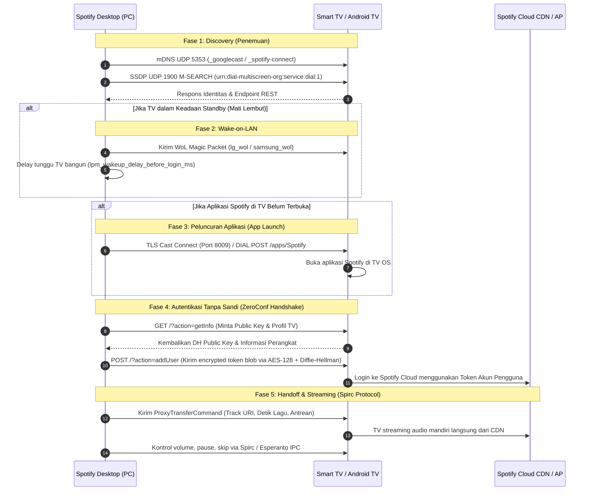

# Analisis Reverse Engineering: Cara Kerja Sambung ke TV pada Spotify Desktop

Dokumen ini mendokumentasikan hasil analisis teknis dan *reverse engineering* terhadap mekanisme **"Sambung ke Perangkat / TV" (Spotify Connect, Cast, & DIAL)** pada Spotify Desktop, berdasarkan data di folder `AppData\Local\Spotify`, pustaka inti `Spotify.dll`, serta bukti koneksi jaringan aktif pada perangkat.

---

## 1. Bukti Observasi Langsung (Live Evidence)

Berdasarkan inspeksi proses dan soket jaringan yang sedang berjalan pada saat pengujian:

1. **Perangkat TV di Jaringan Lokal**:
   * **Nama**: Toshiba TV (Android TV dengan Chromecast built-in)
   * **Alamat IP**: `192.168.1.5`
   * **Revisi Cast Firmware**: `3.74.mediashell_clone_374_20260921.00_RC01.987225940`
2. **Koneksi Jaringan Aktif dari Spotify Desktop**:
   * `PID 19048` (Spotify.exe): Terhubung ke `192.168.1.5:8009` (status `ESTABLISHED`) — port protokol Google Cast (TLS).
   * `PID 3056` (Spotify.exe): Membuka port listening lokal:
     * **UDP 5353 (mDNS / Multicast DNS)**: Untuk penemuan `_spotify-connect._tcp.local` dan `_googlecast._tcp.local`.
     * **UDP 1900 (SSDP)**: Mengirim probe multicast `239.255.255.250:1900` untuk penemuan TV via **DIAL (Discovery and Launch)**.
     * **TCP 38473 -> 34.158.1.133:4070**: Sesi kontrol Access Point (AP) Spotify untuk sinkronisasi cloud cluster.

---

## 2. Struktur File Terkait di `AppData\Local\Spotify`

Folder `AppData\Local\Spotify` bertindak sebagai penyimpanan konfigurasi lokal, status pemutaran aktif, dan basis data *Chromium Embedded Framework* (CEF).

| Nama File / Path | Format | Peran dalam Sambung ke TV |
| :--- | :--- | :--- |
| `device_settings` | Protobuf / Biner | Menyimpan `device_id` lokal PC (`ddc8bf9eaf9f1749579d3c5acb5cb6b919267480`), ID perangkat keras, dan status inisialisasi sinkronisasi perangkat (`enable_device_settings_init_fetch`). |
| `Users\<user-id>\properties.bin` | Key-Value Biner | Cache *Remote Configuration* (`core-connect-feature2`) yang mengatur timeout dan perilaku koneksi ke TV: timeout Cast, DIAL, WoL Samsung/LG, dan mDNS Zeroconf. |
| `Users\<user-id>\restrictions_playback_observer.state` | Protobuf | Menyimpan *snapshot state* pemutaran lagu saat ini (`context_uri`, posisi detik lagu `media.start_position`, metadata antrean). State ini yang dipaketkan dan dikirimkan ke TV saat transfer pemutaran. |
| `Users\<user-id>\primary.ldb` | LevelDB | Database lokal yang menyimpan cache riwayat perangkat yang pernah terhubung, metadata Spotify, serta token sesi login. |
| `Data\` | Cache Terfragmentasi | Direktori cache audio lokal terenkripsi (sharded 00-ff). Catatan: File ini tidak ditransfer ke TV karena TV mengunduh stream mandiri. |

---

## 3. Diagram Alur Kerja Koneksi ke TV



---

## 4. Analisis Rinci Protokol Inti (Berdasarkan `Spotify.dll`)

### A. Protokol Penemuan (Multi-Discovery Strategy)
Spotify menggunakan strategi berlapis agar dapat menemukan semua jenis merk TV:
1. **Google Cast (`ArtisanalCast`)**:
   * Menggunakan modul `ArtisanalCast::Coordinator` dan `ArtisanalCast::Router`.
   * Mendeteksi perangkat via mDNS `_googlecast._tcp`.
   * Digunakan untuk Android TV, Google TV, dan perangkat Chromecast built-in (seperti Toshiba TV pada pengujian).
2. **DIAL Protocol (Discovery and Launch)**:
   * Mengirim probe SSDP `M-SEARCH * HTTP/1.1` dengan header `ST: urn:dial-multiscreen-org:service:dial:1`.
   * Membaca `dial_rest_service_url` dari deskripsi perangkat UPnP.
   * Digunakan untuk meluncurkan Spotify pada Samsung Tizen, LG webOS, dan Amazon Fire TV (`prefer_dial_for_amazon_devices`).
3. **Spotify Zeroconf**:
   * Menggunakan service name `_spotify-connect._tcp.local`.
   * Digunakan jika aplikasi Spotify di TV sudah aktif dan membuka HTTP listener lokal.
4. **Cloud Cluster (`spotify.connectstate.Cluster`)**:
   * Menghubungkan perangkat yang berada di bawah akun yang sama melalui WebSocket/Hermes (`dealer.spotify.com`).

### B. Mekanisme Wake-on-LAN (WoL)
Pada kode mesin `Spotify.dll`, terdapat struktur protobuf `spotify.connectstate.WakeOnLanInfo`:
* `mac_address`: Alamat fisik kartu jaringan TV.
* `port`: Port UDP untuk magic packet (biasanya port 9 atau 7).
* `retries` & `delay_ms`: Parameter pengulangan pengiriman paket.
* Parameter khusus vendor:
  * `lg_wol_minimum_ms_to_abort_by_transfer_to_same_device`
  * `samsung_wol_minimum_ms_to_abort_by_transfer_to_same_device`
  * `lpm_wakeup_delay_before_login_ms` (jeda waktu untuk TV beralih dari *Low Power Mode* ke status aktif sebelum login).

### C. ZeroConf Login & Enkripsi
Untuk memasukkan akun ke TV tanpa mengharuskan pengguna mengetikkan password pada remote TV:
1. Desktop mengeksekusi `ConnectZeroconfLoginProtocol::starting getInfo`.
2. TV mengembalikan kunci publik Diffie-Hellman (`clientKey`).
3. Desktop mengenkripsi token autentikasi pengguna ke dalam format `blob`.
4. Desktop memanggil `action=addUser` dengan parameter:
   ```http
   POST /?action=addUser HTTP/1.1
   Content-Type: application/x-www-form-urlencoded

   userName=<username>&blob=<encrypted_auth_blob>&clientKey=<desktop_pub_key>&tokenType=<type>&loginId=<uuid>
   ```

### D. Protokol Kendali Pemutaran (Spirc & Esperanto ConnectState)
Setelah TV berhasil masuk ke sesi:
1. **Transfer Pemutaran**:
   * Desktop mengirim pesan Protobuf `spotify.connectstate.ProxyTransferCommand`.
   * State diambil dari snapshot lokal `restrictions_playback_observer.state` (ID lagu, posisi milidetik `media.start_position`, antrean, shuffle, repeat).
2. **Pemisahan Jalur Audio dan Jalur Kontrol**:
   * **Jalur Audio**: TV melakukan *direct stream* dari CDN Spotify (`audio/ogg`, `audio/aac`). Audio **tidak dialirkan dari laptop ke TV**.
   * **Jalur Kontrol**: Laptop bertindak murni sebagai pengendali jarak jauh (*controller*) menggunakan protokol **Spirc** (Spotify Remote Control) melalui perintah protobuf seperti `SetVolumeCommand`, `disallow_seeking_reasons`, dan `player_state_changed`.

---

## 5. Ringkasan Kesimpulan

* Folder `AppData\Local\Spotify` menyimpan identitas unik perangkat PC (`device_settings`), konfigurasi batas transfer perangkat (`properties.bin`), dan status lagu yang siap ditransfer (`restrictions_playback_observer.state`).
* Koneksi ke TV tidak bergantung pada satu protokol saja, melainkan gabungan **mDNS/SSDP (pencarian)**, **WoL (menyalakan TV)**, **DIAL/Cast (peluncuran aplikasi)**, **ZeroConf DH/AES (login otomatis)**, dan **Spirc/Protobuf (kendali pemutaran jarak jauh)**.
* Audio diputar langsung oleh sistem operasi TV dari server cloud Spotify, sementara aplikasi desktop di laptop berfungsi sebagai *remote controller*.
